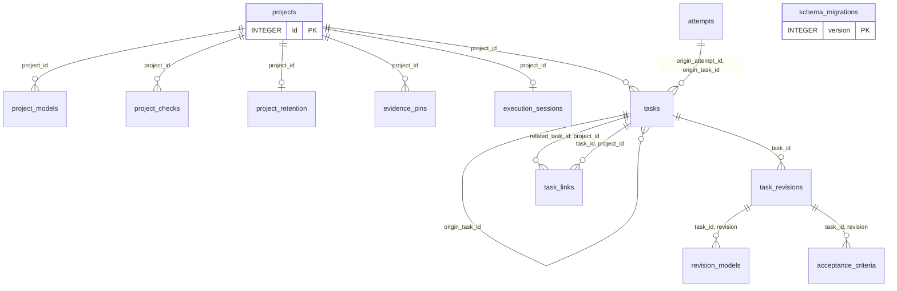
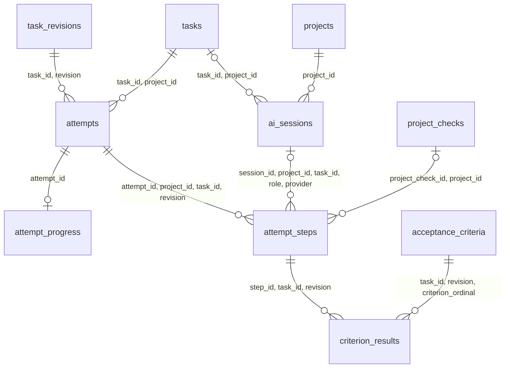
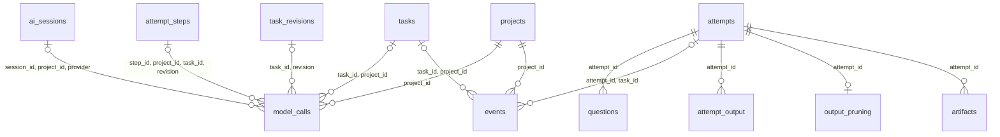

# Database schema V1

Sources: [initial schema](../migrations/0001_relational_state.sql),
[ordering](../src/storage/ordering.rs), [execution records](../src/storage/execution.rs),
[token normalization](../src/storage/usage.rs).

This is the unreleased first schema. Edit 0001 in place. On open, an existing V1
database is reconciled inside one transaction: the live schema must match its recorded
definition, retained columns are copied into the current definition, and integrity and
foreign keys must pass. Reconciliation refuses retained REAL values because the current
row comparison cannot verify their binary identity. Incompatible edits leave the database unchanged and require the
previous binary or a backup. No conversion migrations are maintained.

## Lifecycle and current task

| Record | States | Meaning |
| --- | --- | --- |
| Task | new, ready, blocked, succeeded, succeeded_override, failed_skipped, superseded, cancelled, deleted | Readiness and final resolution, NOT live execution state |
| Revision | draft, ready, rejected, retired | Approval of an exact definition, limits, and model configuration |
| Attempt | running, paused, waiting, succeeded, failed, interrupted, cancelled | Execution state; retry creates another attempt, resume does not |
| Execution session | running, waiting, paused, stopped, completed | Project scheduler intent and stop reason; independent of the attempt |

task_details selects the newest **ready** revision. A newer draft appears separately as
pending_revision/title/goal and does not replace approved inputs. Rejected/retired revisions
are excluded. With no ready revision, the task remains visible but cannot run; its draft can
supply the display title. Attempts always retain their exact revision.

The displayed status combines task readiness/resolution with attempt state; it is a view, not
a second stored lifecycle. Running is pinned by the attempt. Otherwise current is the first
unfinished task in execution order: failure blocks later work, but insertion before non-running
current can make remediation current. New/unapproved current is never silently skipped.

Planner/remediator work uses ordinary tasks, not proposal tables. Approval is a human or AI
decision on the revision. An override/skip/supersede resolves the task without rewriting its
attempts. Escalation creates a new revision with new role settings.
An active execution worker may use the supervisor's absolute executable and its attempt token
to file a follow-up draft immediately after current. The CLI sends the request through a
guardian-owned endpoint in the worker's TMPDIR; only the guardian opens SQLite and applies this
command. The draft records both origin IDs and AI creator attribution. The worker sandbox cannot
write the supervisor's state root, and the endpoint accepts no other mutation.

## Waiting and limits

attempts.wait_reason distinguishes question, rate_limit, and provider_unavailable. A wait
records waiting_since_ms and optional resume_at_ms (earliest UTC resume time). A rate limit
normally suspends the same attempt; it is not a failed coding attempt. Question waits require
answers before resumption. Wait events retain the history after the current wait fields clear.
CLI `show` exposes `waiting_ms` on each attempt and `provider_elapsed_ms` on each role usage
record. Open wait and provider intervals advance on fresh reads; completed intervals stay fixed.
Recovery caps an open interval at the attempt's recorded finish time. Current Task refreshes
live timing, while an open details or statistics dialog shows the snapshot taken when opened.
A rate limit waits until the provider's named reset time plus one minute; without one it backs
off 1, 2, 4, then every 8 minutes. Limits never fail the task. Provider transport errors before
the next completed turn count as the same outage; a completed turn resets the streak.

Each revision has attempt_limit, attempt_timeout_ms (the task limit) and stage_timeout_ms
(the stage limit), each positive or NULL = unlimited. Both time limits are off by default; when
switched on they are 6 hours and 30 minutes. New, imported and planned tasks default to no time
limits; inserted repairs inherit the failed task's limits.
attempt_limit applies across ALL revisions of the task; escalation does not reset usage.
attempts_used counts succeeded attempts and failures in check/review/validation/agent/unknown.
Rate-limit, transport, environment, protocol, timeout, interruption, and cancellation do not
consume the coding-attempt budget. Number is an audit sequence, not budget usage.
Here timeout means an infrastructure/request timeout. Exhausting the active execution limit
is an agent failure and consumes budget; it must not be mislabeled as infrastructure.

attempt_timeout_ms limits cumulative active execution time across the task's attempts, using
the active revision's configured limit. Paused and waiting time never enters active_ms. Start
checks the attempt budget; resume checks elapsed active time and the wait deadline. The
supervisor accounts active time with a monotonic clock, stops work at the limit, and flushes
terminal evidence after worker shutdown. Individual check timeouts remain separate.
Automatic judge replans share a durable ten-handoff budget with inserted prerequisites.
When prerequisites are inserted at an exhausted coding limit, one retry is reserved in a
new ready revision; old attempts keep their original revision and limits.

## Storage conventions

One SQLite file per instance state root; projects have independent queues. Project names are
nonblank and UNIQUE using SQLite BINARY comparison (case-sensitive). Production, development,
and tests never share roots. Every table is STRICT. PK = primary key, FK = foreign key,
UQ = uniqueness. Integer IDs are AUTOINCREMENT; schema versions are not. NULL means unknown or
absent, not zero. Timestamps/durations are integer milliseconds; money is integer micro-USD.

Every task, including History, has a non-null `order_key`, unique within its project. Keys are
opaque, canonical lowercase hexadecimal fractional strings with no trailing zero. BINARY
string comparison is execution order; keys are not task numbers or hierarchy. The allocator
handles prepend, append, nested insertion, and balanced batches without shifting other tasks.
It considers historical keys too, because they still occupy the ordering space.

All FKs are immediate NO ACTION for delete/update. There is no selected-revision cycle and
no workflow trigger. Shared commands own transitions and atomic multi-table writes; SQL owns
types, required fields, enums, reference integrity, and uniqueness. Direct SQL is not a command API.

## ERD

Each edge is an actual FK. Labels list composite columns. || = one, o| = zero or one,
o{ = zero or many. Composite uniqueness is retained only where an FK uses that exact scope.

### Definitions



### Execution



### Evidence



## Table definitions

Every column, PK, FK, unique constraint, and explicit index is listed. Integer PKs are non-null.

### acceptance_criteria

Ordered, nonblank acceptance criteria attached to an exact revision; ordinal is positive.

| Column | Type | Nullable | Definition |
| --- | --- | --- | --- |
| `task_id` | INTEGER | no | Owning task. |
| `revision` | INTEGER | no | Exact task revision number. |
| `ordinal` | INTEGER | no | Positive order within its parent. |
| `description` | TEXT | no | Required observable outcome, not a command. |

- PK `(task_id, revision, ordinal)`.
- FK `(task_id, revision)` → `task_revisions(task_id, revision)`.

### ai_sessions

Durable provider chat identity, independent of attempts and worker processes. Compatible retries may reuse a session; different roles have separate sessions. A project planning session need not belong to a task.

| Column | Type | Nullable | Definition |
| --- | --- | --- | --- |
| `id` | INTEGER | no | Stable row ID. |
| `project_id` | INTEGER | no | Owning project. |
| `task_id` | INTEGER | yes | Task scope; NULL for project-wide planning. |
| `role` | TEXT | no | planning, execution, review, validation, remediation. |
| `provider` | TEXT | no | Provider/adapter identifier; never a credential. |
| `provider_scope` | TEXT | no | Nonsecret provider account/workspace namespace. |
| `provider_session_id` | TEXT | yes | Opaque resumable provider session ID; NULL until assigned. |
| `state` | TEXT | no | open, closed, unavailable. |
| `created_at_ms` | INTEGER | no | Creation time. |
| `last_used_at_ms` | INTEGER | no | Last use time, not before creation. |

- PK `(id)`.
- FK `(task_id, project_id)` → `tasks(id, project_id)`.
- FK `(project_id)` → `projects(id)`.
- Index `ix_sessions_task`: `INDEX ix_sessions_task ON ai_sessions(task_id, project_id)`.
- UQ `(id, project_id, task_id, role, provider)`.
- UQ `(id, project_id, provider)`.
- UQ `(provider, provider_scope, provider_session_id)`.

### artifacts

Retained files outside SQLite, owned by an attempt. Paths are unique within the instance artifact root. Commands validate containment and reject traversal/symlink escapes; pruning removes bytes and retains metadata.

| Column | Type | Nullable | Definition |
| --- | --- | --- | --- |
| `id` | INTEGER | no | Stable row ID. |
| `attempt_id` | INTEGER | no | Owning attempt. |
| `name` | TEXT | no | Nonblank name. |
| `media_type` | TEXT | no | Nonblank content type. |
| `relative_path` | TEXT | no | Path under the instance artifact root, never the project root. |
| `size_bytes` | INTEGER | no | Nonnegative retained byte count. |
| `created_at_ms` | INTEGER | no | Creation time. |
| `pruning_requested_at_ms` | INTEGER | yes | Durable cleanup intent; NULL until selected. Retry reconciles interrupted deletion. |
| `pruned_at_ms` | INTEGER | yes | Deletion time; NULL while retained. |

- PK `(id)`.
- FK `(attempt_id)` → `attempts(id)`.
- Index `ix_artifacts_attempt`: `INDEX ix_artifacts_attempt ON artifacts(attempt_id, id)`.
- UQ `(relative_path)`.

### attempt_output

Ordered output chunks, not one row per character. Writer assigns a positive monotonic sequence per attempt and batches chunks in short transactions.

| Column | Type | Nullable | Definition |
| --- | --- | --- | --- |
| `attempt_id` | INTEGER | no | Owning attempt. |
| `sequence` | INTEGER | no | Positive per-attempt output cursor. |
| `stream` | TEXT | no | stdout, stderr, system. |
| `recorded_at_ms` | INTEGER | no | Chunk capture time. |
| `content` | TEXT | no | Text chunk; no structured entity dump. |

- PK `(attempt_id, sequence)`.
- FK `(attempt_id)` → `attempts(id)`.

### attempt_progress

Durable phase within one attempt. Initial implementation is round zero; at most ten repair rounds follow. Pause, rate waits and resume retain this row and the current evidence. Automatic revision/prerequisite handoffs carry the original task’s round count; only a successfully applied replan authorizes the successor worker. Source fingerprints invalidate stale proof before checks/review/validation or checkpointing. Findings do not close the attempt or consume another coding attempt. After every fix, current check/review/validation evidence is regenerated. Minor findings may be accepted only with all required criteria and checks satisfied; unresolved critical findings wait for a decision after round ten.

| Column | Type | Nullable | Definition |
| --- | --- | --- | --- |
| `attempt_id` | INTEGER | no | Owning attempt. |
| `repair_round` | INTEGER | no | Zero for implementation, then 1 through 10. |
| `phase` | TEXT | no | implement, judge, replanned, fix, check, review, validate, decide, complete. |
| `context` | TEXT | no | Current findings and authorized repair plan. |
| `evidence` | TEXT | no | Current round's assessments and durable transcript references. |
| `verified_tree` | TEXT | no | Git tree fingerprint binding the retained proof to source content. |

- PK `(attempt_id)`.
- FK `(attempt_id)` → `attempts(id)`.

### attempt_steps

Ordered phases inside an attempt. A completed assessment requesting fixes has state changes_requested; its provider call succeeded. Unmet criterion evidence uses needs_work, not a failed task. AI phases record session/provider/model and optional effort; tool checks record command context. Terminal steps require finish time. The two composite parent keys enforce exact revision/project references in criterion_results and model_calls; attempt_id/ordinal enforces phase order.

Check counts sum completed Rust test-harness summaries in each retained transcript. All three counts are NULL when no supported summary was reported. Review and validation see the current run and the latest successful check from the checkpoint matching the attempt's base commit. Validation requests a repair when passed tests drop, ignored tests rise, or a previously counted check stops reporting counts.

| Column | Type | Nullable | Definition |
| --- | --- | --- | --- |
| `id` | INTEGER | no | Stable row ID. |
| `attempt_id` | INTEGER | no | Owning attempt. |
| `project_id` | INTEGER | no | Owning project. |
| `task_id` | INTEGER | no | Owning task. |
| `revision` | INTEGER | no | Exact task revision number. |
| `ordinal` | INTEGER | no | Positive order within its parent. |
| `role` | TEXT | no | execution, check, review, validation, remediation. |
| `state` | TEXT | no | running, succeeded, failed, interrupted, skipped. |
| `session_id` | INTEGER | yes | Required for AI phases, absent for checks. |
| `provider` | TEXT | yes | Actual AI provider; absent for checks. |
| `model` | TEXT | yes | Actual AI model; absent for checks. |
| `effort` | TEXT | yes | Provider-supported effort; NULL means no effort setting, not an invented sentinel. |
| `invocation` | TEXT | yes | start, resume, nudge; absent for checks. |
| `project_check_id` | INTEGER | yes | Configured tool check, if applicable; actual command is also snapshotted. |
| `command` | TEXT | yes | Shell command executed by the supervisor. |
| `working_directory` | TEXT | yes | Working directory relative to the project root; validated by runner. |
| `timeout_ms` | INTEGER | yes | Positive execution timeout. |
| `exit_code` | INTEGER | yes | Tool exit status; NULL if no exit was observed. |
| `passed_count` | INTEGER | yes | Nonnegative passed test count parsed from the check transcript; NULL when no supported summary was found. |
| `failed_count` | INTEGER | yes | Nonnegative failed test count, stored with passed and ignored counts. |
| `ignored_count` | INTEGER | yes | Nonnegative ignored test count, stored with passed and failed counts. |
| `started_at_ms` | INTEGER | no | Start time. |
| `finished_at_ms` | INTEGER | yes | Finish time; NULL while active. |
| `report` | TEXT | yes | Human-readable summary/evidence; not a serialized entity. |

- PK `(id)`.
- FK `(project_check_id, project_id)` → `project_checks(id, project_id)`.
- FK `(session_id, project_id, task_id, role, provider)` → `ai_sessions(id, project_id, task_id, role, provider)`.
- FK `(attempt_id, project_id, task_id, revision)` → `attempts(id, project_id, task_id, revision)`.
- Index `ix_steps_check`: `INDEX ix_steps_check ON attempt_steps(project_check_id)`.
- Index `ix_steps_session`: `INDEX ix_steps_session ON attempt_steps(session_id)`.
- UQ `(id, task_id, revision)`.
- UQ `(id, project_id, task_id, revision)`.
- UQ `(attempt_id, ordinal)`.

### attempts

One execution against an exact revision; retry creates another row. This is the sole source of running/paused/waiting/failed status. One live attempt per task and one running attempt per project. Terminal attempts require finish time/outcome; failures/interruption also require a category. Waiting requires a reason and start time.

| Column | Type | Nullable | Definition |
| --- | --- | --- | --- |
| `id` | INTEGER | no | Stable row ID. |
| `project_id` | INTEGER | no | Owning project. |
| `task_id` | INTEGER | no | Owning task. |
| `revision` | INTEGER | no | Exact task revision number. |
| `number` | INTEGER | no | Positive attempt number unique per task. |
| `state` | TEXT | no | running, paused, waiting, succeeded, failed, interrupted, cancelled. |
| `execution_token` | TEXT | no | Unique invocation/fencing token for worker callbacks. |
| `started_at_ms` | INTEGER | no | Start time. |
| `finished_at_ms` | INTEGER | yes | Finish time; NULL while active. |
| `active_ms` | INTEGER | no | Accumulated active duration, nonnegative; default 0. |
| `rate_waits` | INTEGER | no | Rate-limit waits since the last completed provider turn, capped at three; sets the backoff. |
| `wait_reason` | TEXT | yes | question, rate_limit, provider_unavailable; required only while waiting. |
| `waiting_since_ms` | INTEGER | yes | Start of the current wait; required only while waiting. |
| `resume_at_ms` | INTEGER | yes | Earliest resume time for a timed wait; NULL means no scheduled time. |
| `outcome` | TEXT | yes | Nonblank terminal attempt outcome. |
| `failure_category` | TEXT | yes | rate_limit, timeout, transport, environment, protocol, check, review, validation, agent, interrupted, unknown. |
| `base_commit` | TEXT | yes | Checkout commit before this attempt, if available. |
| `head_commit` | TEXT | yes | Resulting commit, if available. |
| `report` | TEXT | yes | Human-readable summary/evidence; not a serialized entity. |

- PK `(id)`.
- FK `(task_id, revision)` → `task_revisions(task_id, revision)`.
- FK `(task_id, project_id)` → `tasks(id, project_id)`.
- Index `ix_attempts_revision`: `INDEX ix_attempts_revision ON attempts(task_id, revision)`.
- Index `ix_attempts_project`: `INDEX ix_attempts_project ON attempts(project_id, id)`.
- Index `ux_running_attempt_project`: `UNIQUE INDEX ux_running_attempt_project ON attempts(project_id) WHERE state = 'running'`.
- Index `ux_live_attempt_task`: `UNIQUE INDEX ux_live_attempt_task ON attempts(task_id) WHERE state IN ('running', 'paused', 'waiting')`.
- UQ `(id, project_id, task_id, revision)`.
- UQ `(id, task_id)`.
- UQ `(task_id, number)`.
- UQ `(execution_token)`.

### criterion_results

A step's verdict and evidence for one criterion of the same revision. Terminal verdicts require nonblank evidence.

| Column | Type | Nullable | Definition |
| --- | --- | --- | --- |
| `step_id` | INTEGER | no | Step producing this verdict. |
| `task_id` | INTEGER | no | Owning task. |
| `revision` | INTEGER | no | Exact task revision number. |
| `criterion_ordinal` | INTEGER | no | Exact acceptance criterion ordinal. |
| `state` | TEXT | no | running, passed, failed, skipped. |
| `evidence` | TEXT | yes | Observed result; mandatory for terminal verdicts. |

- PK `(step_id, criterion_ordinal)`.
- FK `(task_id, revision, criterion_ordinal)` → `acceptance_criteria(task_id, revision, ordinal)`.
- FK `(step_id, task_id, revision)` → `attempt_steps(id, task_id, revision)`.
- Index `ix_criteria_results_definition`: `INDEX ix_criteria_results_definition ON criterion_results(task_id, revision, criterion_ordinal)`.

### default_models

Model defaults a newly registered project starts with. They are copied once, at registration; each project then keeps and edits its own `project_models`.

| Column | Type | Nullable | Definition |
| --- | --- | --- | --- |
| `role` | TEXT | no | planning, execution, review, validation, remediation. |
| `provider` | TEXT | no | Provider/adapter identifier; never a credential. |
| `model` | TEXT | no | Explicit model identifier. |
| `effort` | TEXT | yes | Provider-supported effort; NULL means no effort setting. |

- PK `(role)`.

### events

Append-only command/runner audit and activity feed. Task and attempt are optional, but an attempt requires its matching task. Commands append events atomically with state changes.

| Column | Type | Nullable | Definition |
| --- | --- | --- | --- |
| `id` | INTEGER | no | Stable row ID. |
| `project_id` | INTEGER | no | Owning project. |
| `task_id` | INTEGER | yes | Optional task context in this project. |
| `attempt_id` | INTEGER | yes | Optional attempt of that task. |
| `occurred_at_ms` | INTEGER | no | Event time. |
| `kind` | TEXT | no | Namespaced event type, e.g. task.override. |
| `level` | TEXT | no | info, warning, error. |
| `message` | TEXT | no | Nonblank readable event detail. |

- PK `(id)`.
- FK `(attempt_id, task_id)` → `attempts(id, task_id)`.
- FK `(task_id, project_id)` → `tasks(id, project_id)`.
- FK `(project_id)` → `projects(id)`.
- Index `ix_events_attempt`: `INDEX ix_events_attempt ON events(attempt_id, id)`.
- Index `ix_events_task`: `INDEX ix_events_task ON events(task_id, id)`.
- Index `ix_events_project`: `INDEX ix_events_project ON events(project_id, id)`.

### evidence_pins

Interactive remediation owns a durable evidence pin before it reads failure evidence.
Pins defer project cleanup even after the failed task is resolved. Owner and guardian
locks live under `evidence-pins/` in the database state root. The guardian reservation
is written before spawn and stays nonempty until descendants have been reaped.
Preview and both cleanup rechecks recover a pin only when both locks are idle and
its guardian marker is empty and persisted directory/lock inode identities match.
Missing or substituted guards fail closed; recovery never recreates a guard as proof
of idleness. A durable `evidence-pins.identity` file binds orphan cleanup to the
original directory even when no pin rows remain; unknown directories are not swept. Descriptor-relative, no-follow opens keep recovery in its original state
root. The provider uses the original guardian descriptor, and release uses a database
connection opened and checked before launch. Abnormal guardian exits retain evidence
without PID or timeout inference. Completed pins remove their lock files after commit;
recovery also removes idle orphan files left by interrupted creation or retirement.

| Column | Type | Nullable | Meaning |
| --- | --- | --- | --- |
| `id` | TEXT | no | Random 32-character lowercase hexadecimal ownership key |
| `project_id` | INTEGER | no | Project whose evidence is protected |
| `directory_identity` | TEXT | no | Original guard directory device and inode |
| `owner_identity` | TEXT | no | Original owner lock device and inode |
| `guardian_identity` | TEXT | no | Original guardian lock device and inode |

- PK `(id)`.
- FK `(project_id)` → `projects(id)`.
- Index `ix_evidence_pins_project`: `INDEX ix_evidence_pins_project ON evidence_pins(project_id)`.

### execution_sessions

One project-scoped execution policy. The mode records the actual started run, separate
from the saved preference used for the next explicit Run. A waiting queue resumes after
an authorized intervention; paused and Run one sessions require another Run. The
workspace lease and explicit worker recovery still govern execution.

| Column | Type | Nullable | Definition |
| --- | --- | --- | --- |
| `project_id` | INTEGER | no | Owning project. |
| `mode` | TEXT | no | queue or one. |
| `state` | TEXT | no | running, waiting, resume_requested, paused, stopped, completed. |
| `reason` | TEXT | no | Durable reason for the current scheduler state. |
| `updated_at_ms` | INTEGER | no | Last state change time. |

- PK `(project_id)`.
- FK `(project_id)` → `projects(id)`.

### model_calls

Billable provider requests, including project planning before a task exists. Input is always UNCACHED input; cache-read and cache-write are disjoint buckets. Running calls have no finish/error; failed/interrupted calls require both.

| Column | Type | Nullable | Definition |
| --- | --- | --- | --- |
| `id` | INTEGER | no | Stable row ID. |
| `project_id` | INTEGER | no | Owning project. |
| `task_id` | INTEGER | yes | Task context, or NULL for project planning. |
| `revision` | INTEGER | yes | Exact task revision; NULL together with task_id. |
| `step_id` | INTEGER | yes | Attempt phase, if this call belongs to execution. |
| `session_id` | INTEGER | yes | Actual session when applicable; NULL for calls without a session. |
| `role` | TEXT | no | planning, execution, review, validation, remediation. |
| `provider` | TEXT | no | Provider/adapter identifier; never a credential. |
| `model` | TEXT | no | Explicit model identifier. |
| `effort` | TEXT | yes | Provider-supported effort; NULL means no effort setting, not an invented sentinel. |
| `request_key` | TEXT | no | Unique idempotency/correlation key. |
| `state` | TEXT | no | running, succeeded, failed, interrupted. |
| `started_at_ms` | INTEGER | no | Start time. |
| `finished_at_ms` | INTEGER | yes | Finish time; NULL while active. |
| `input_tokens` | INTEGER | yes | Uncached input tokens for every provider; NULL means unreported. |
| `cache_read_tokens` | INTEGER | yes | Tokens read from cache, disjoint from uncached input and cache writes. |
| `cache_write_tokens` | INTEGER | yes | Tokens written to cache, disjoint from uncached input and cache reads. |
| `output_tokens` | INTEGER | yes | Provider-reported output count; nullable, nonnegative. |
| `cost_microusd` | INTEGER | yes | Authoritative normalized cost, nonnegative; NULL means unreported. |
| `error` | TEXT | yes | Nonblank failure/interruption explanation; otherwise NULL. |

- PK `(id)`.
- FK `(session_id, project_id, provider)` → `ai_sessions(id, project_id, provider)`.
- FK `(step_id, project_id, task_id, revision)` → `attempt_steps(id, project_id, task_id, revision)`.
- FK `(task_id, revision)` → `task_revisions(task_id, revision)`.
- FK `(task_id, project_id)` → `tasks(id, project_id)`.
- FK `(project_id)` → `projects(id)`.
- Index `ix_calls_session`: `INDEX ix_calls_session ON model_calls(session_id)`.
- Index `ix_calls_step`: `INDEX ix_calls_step ON model_calls(step_id)`.
- Index `ix_calls_task`: `INDEX ix_calls_task ON model_calls(task_id, revision, id)`.
- Index `ix_calls_project`: `INDEX ix_calls_project ON model_calls(project_id, id)`.
- UQ `(request_key)`.

### output_pruning

One marker per attempt whose output content was deliberately removed. Task, attempt, step and judgment records remain intact.

| Column | Type | Nullable | Definition |
| --- | --- | --- | --- |
| `attempt_id` | INTEGER | no | Owning attempt. |
| `pruned_at_ms` | INTEGER | no | Cleanup time. |
| `size_bytes` | INTEGER | no | Original output content bytes. |

- PK `(attempt_id)`.
- FK `(attempt_id)` → `attempts(id)`.

### project_checks

Configured tool commands (tests, Clippy, etc.), distinct from AI review and goal validation. A step snapshots the command actually executed.

| Column | Type | Nullable | Definition |
| --- | --- | --- | --- |
| `id` | INTEGER | no | Stable row ID. |
| `project_id` | INTEGER | no | Owning project. |
| `name` | TEXT | no | Nonblank name. |
| `command` | TEXT | no | Shell command executed by the supervisor. |
| `working_directory` | TEXT | no | Working directory relative to the project root; validated by runner. |
| `timeout_ms` | INTEGER | no | Positive execution timeout. |
| `enabled` | INTEGER | no | 0 disabled; 1 enabled. |

- PK `(id)`.
- FK `(project_id)` → `projects(id)`.
- UQ `(id, project_id)`.
- UQ `(project_id, name)`.

### project_models

Default model configuration per project role. Copy into each new revision; later default changes do not change existing tasks.

| Column | Type | Nullable | Definition |
| --- | --- | --- | --- |
| `project_id` | INTEGER | no | Owning project. |
| `role` | TEXT | no | planning, execution, review, validation, remediation. |
| `provider` | TEXT | no | Provider/adapter identifier; never a credential. |
| `model` | TEXT | no | Explicit model identifier. |
| `effort` | TEXT | yes | Provider-supported effort; NULL means no effort setting, not an invented sentinel. |

- PK `(project_id, role)`.
- FK `(project_id)` → `projects(id)`.

### projects

Registered checkout. Names and canonical native root paths are independently unique.

| Column | Type | Nullable | Definition |
| --- | --- | --- | --- |
| `id` | INTEGER | no | Stable row ID. |
| `name` | TEXT | no | Nonblank name. |
| `root_path` | BLOB | no | Canonical native absolute path bytes (not necessarily UTF-8). |
| `created_at_ms` | INTEGER | no | Creation time. |
| `agent_network` | INTEGER | no | 1 lets writable agent turns use the network; 0 (default) leaves Codex's sandbox without it. |

- PK `(id)`.
- UQ `(root_path)`.
- UQ `(name)`.

### project_retention

Project-specific minimum age for terminal attempts on closed tasks. A missing row means 30 days; version guards concurrent policy edits.

| Column | Type | Nullable | Definition |
| --- | --- | --- | --- |
| `project_id` | INTEGER | no | Owning project. |
| `days` | INTEGER | no | Minimum completed attempt age in days; 0 allows immediate cleanup. |
| `version` | INTEGER | no | Positive policy version. |

- PK `(project_id)`.
- FK `(project_id)` → `projects(id)`.

### questions

Human intervention requested during an attempt. Open has no answer/resolution; answered requires answer, actor, and resolution time; cancelled has resolution time only.

| Column | Type | Nullable | Definition |
| --- | --- | --- | --- |
| `id` | INTEGER | no | Stable row ID. |
| `attempt_id` | INTEGER | no | Owning attempt. |
| `prompt` | TEXT | no | Nonblank question. |
| `state` | TEXT | no | open, answered, cancelled. |
| `answer` | TEXT | yes | Nonblank answer for answered state only. |
| `answered_by` | TEXT | yes | Answering actor identifier. |
| `created_at_ms` | INTEGER | no | Creation time. |
| `resolved_at_ms` | INTEGER | yes | Answer/cancellation time, not before creation. |

- PK `(id)`.
- FK `(attempt_id)` → `attempts(id)`.
- Index `ix_questions_attempt`: `INDEX ix_questions_attempt ON questions(attempt_id, id)`.

### revision_models

Effective model/effort per role for one exact revision. AI approval/start requires all four roles. No implicit live inheritance from project defaults.

| Column | Type | Nullable | Definition |
| --- | --- | --- | --- |
| `task_id` | INTEGER | no | Owning task. |
| `revision` | INTEGER | no | Exact task revision number. |
| `role` | TEXT | no | execution, review, validation, remediation. |
| `provider` | TEXT | no | Provider/adapter identifier; never a credential. |
| `model` | TEXT | no | Explicit model identifier. |
| `effort` | TEXT | yes | Provider-supported effort; NULL means no effort setting, not an invented sentinel. |

- PK `(task_id, revision, role)`.
- FK `(task_id, revision)` → `task_revisions(task_id, revision)`.

### schema_migrations

Immutable migration ledger. Exact applied SQL detects changed migration files; version is positive and name unique.

| Column | Type | Nullable | Definition |
| --- | --- | --- | --- |
| `version` | INTEGER | no | Positive migration number, not AUTOINCREMENT. |
| `name` | TEXT | no | Nonblank name. |
| `sql` | TEXT | no | Exact applied migration SQL. |
| `applied_at_ms` | INTEGER | no | Application timestamp. |

- PK `(version)`.
- UQ `(name)`.

### task_links

Directed relationships between ordinary tasks in the same project. Self-links are forbidden; dependency cycles are rejected by commands.

| Column | Type | Nullable | Definition |
| --- | --- | --- | --- |
| `project_id` | INTEGER | no | Owning project. |
| `task_id` | INTEGER | no | Owning task. |
| `related_task_id` | INTEGER | no | Target of the directed relationship. |
| `kind` | TEXT | no | repairs, replaces, depends_on, derived_from. |

- PK `(task_id, related_task_id, kind)`.
- FK `(related_task_id, project_id)` → `tasks(id, project_id)`.
- FK `(task_id, project_id)` → `tasks(id, project_id)`.
- Index `ix_task_links_related`: `INDEX ix_task_links_related ON task_links(related_task_id, project_id)`.

### task_revisions

Versioned definition, limits, and approval decision. Select the newest ready revision; expose a newer draft separately. Rejected/retired revisions never mask a usable revision. Commands forbid editing definitions already used by an attempt.

| Column | Type | Nullable | Definition |
| --- | --- | --- | --- |
| `task_id` | INTEGER | no | Owning task. |
| `revision` | INTEGER | no | Exact task revision number. |
| `lifecycle` | TEXT | no | draft, ready, rejected, retired. |
| `kind` | TEXT | no | ai or human. |
| `title` | TEXT | no | Nonblank task title. |
| `goal` | TEXT | no | Nonblank task goal. |
| `change_reason` | TEXT | yes | Why this revision was created. |
| `created_by_kind` | TEXT | no | human, ai, or system; creator attribution, including drafts. |
| `created_by` | TEXT | no | Nonblank creator identifier. |
| `attempt_limit` | INTEGER | yes | Maximum charged attempts for the task across revisions; positive, NULL = unlimited. |
| `attempt_timeout_ms` | INTEGER | yes | Task limit: cumulative active time across all attempts in milliseconds; positive, NULL = unlimited. Waiting/paused time is excluded. |
| `stage_timeout_ms` | INTEGER | yes | Stage limit: longest one agent turn (execution, review, validation, judge or repair) may run without a result, in milliseconds; restarts with every turn; positive, NULL = unlimited. A stalled turn fails as a timeout without spending budget and is repaired automatically. |
| `created_at_ms` | INTEGER | no | Creation time. |
| `decided_at_ms` | INTEGER | yes | Decision time, not before creation. |
| `decided_by_kind` | TEXT | yes | human, ai, system; NULL for draft. |
| `decided_by` | TEXT | yes | Decision actor identifier; NULL for draft. |

- PK `(task_id, revision)`.
- FK `(task_id)` → `tasks(id)`.
- Index `ix_revisions_ready`: `INDEX ix_revisions_ready ON task_revisions(task_id, lifecycle, revision DESC)`.

### tasks

Stable task identity, readiness, and final resolution. Execution status exists only on attempts; terminal lifecycle and closed timestamp must agree. Overrides/skips require actor and reason.

| Column | Type | Nullable | Definition |
| --- | --- | --- | --- |
| `id` | INTEGER | no | Stable row ID. |
| `project_id` | INTEGER | no | Owning project. |
| `order_key` | TEXT | no | Canonical fractional string, BINARY execution order; never NULL. |
| `lifecycle` | TEXT | no | new, ready, blocked, succeeded, succeeded_override, failed_skipped, superseded, cancelled, deleted. |
| `origin` | TEXT | no | human, planner, remediator, import, worker. |
| `origin_task_id` | INTEGER | yes | Source task for a worker draft; required only when origin is worker. |
| `origin_attempt_id` | INTEGER | yes | Source attempt for a worker draft; required only when origin is worker. |
| `recovery_root_id` | INTEGER | yes | Original task whose automatic replan budget this prerequisite shares. |
| `automatic_replans` | INTEGER | no | Number of automatic judge handoffs for the recovery root, at most ten. |
| `row_version` | INTEGER | no | Positive optimistic concurrency version, default 1. |
| `created_at_ms` | INTEGER | no | Creation time. |
| `updated_at_ms` | INTEGER | no | Last command time; not before creation. |
| `closed_at_ms` | INTEGER | yes | Terminal resolution time; NULL for Queue. |
| `resolution_reason` | TEXT | yes | Operator/agent reason; mandatory for override and skip. |
| `resolved_by_kind` | TEXT | yes | human, ai, system; paired with resolved_by. |
| `resolved_by` | TEXT | yes | Actor identifier; mandatory with actor kind. |

- PK `(id)`.
- FK `(project_id)` → `projects(id)`.
- FK `(origin_attempt_id, origin_task_id)` → `attempts(id, task_id)`.
- FK `(origin_task_id)` → `tasks(id)`.
- FK `(recovery_root_id)` → `tasks(id)`.
- Index `ix_tasks_history`: `INDEX ix_tasks_history ON tasks(project_id, closed_at_ms DESC, id DESC)`.
- Index `ix_tasks_origin`: `INDEX ix_tasks_origin ON tasks(origin_task_id, order_key) WHERE origin_task_id IS NOT NULL`.
- UQ `(project_id, order_key)`.
- UQ `(id, project_id)`.

## Views

| View | Definition |
| --- | --- |
| `task_details` | Task + newest ready revision + newer pending draft + latest attempt; status and attempts_used are derived |
| `queue_tasks` | task_details with NULL closed_at_ms |
| `history_tasks` | task_details with non-NULL closed_at_ms |
| `current_tasks` | One queue row per project: running attempt first, otherwise smallest order_key |

revision is NULL if none is ready. pending_revision/title/goal show unapproved work separately.
attempt_revision identifies the actual running/historical inputs, even if a newer revision is
approved. Queries explicitly ORDER BY. Commands create task/definition and finish attempt/task
atomically; direct SQL is not the command API.

## Access patterns and sample SQL

Parameters are bound, not interpolated. NULL cursor means first page. Every write recipe
requires input/ownership checks and rollback on errors or unexpected affected-row counts.
Single-statement mutations are fragments of shared commands, not an invitation to bypass
auditing or row-version checks. Never hold a transaction during model/worker execution.

### Projects and queue

Canonicalize native path bytes before registration. Project names are unique, not display-only.

```sql
-- name: register-project
INSERT INTO projects(name, root_path, created_at_ms)
VALUES (:name, :root_path, :now_ms) RETURNING id;
```

```sql
-- name: list-projects
SELECT id, name, root_path FROM projects ORDER BY name, id;
```

Queue paging uses the unique project/order index. Substring search scans candidate rows;
SQLite lowercasing is not full Unicode folding. Mutation invalidates an order cursor: refresh
around the selected task ID. Search/filter never changes execution order.

```sql
-- name: queue-page
SELECT id, row_version, order_key, lifecycle, status, revision_lifecycle, pending_revision, kind, title
FROM queue_tasks WHERE project_id = :project_id
  AND (:after_key IS NULL OR order_key > :after_key)
  AND (:kind IS NULL OR kind = :kind)
  AND (:search = '' OR instr(lower(title), lower(:search)) > 0
       OR instr(CAST(id AS TEXT), :search) > 0)
ORDER BY order_key LIMIT :limit;
```

```sql
-- name: current-task
SELECT id, row_version, lifecycle, status, revision, revision_lifecycle, kind, title, goal,
       pending_revision, pending_title, pending_goal, latest_attempt_id, attempt_revision,
       wait_reason, waiting_since_ms, resume_at_ms, attempts_used, attempt_limit, attempt_timeout_ms
FROM current_tasks WHERE project_id = :project_id;
```

```sql
-- name: history-page
SELECT id, title, lifecycle, order_key, closed_at_ms FROM history_tasks
WHERE project_id = :project_id
  AND (:before_ms IS NULL OR (closed_at_ms, id) < (:before_ms, :before_id))
ORDER BY closed_at_ms DESC, id DESC LIMIT :limit;
```

### Create ordinary planned work and approve it

Capture the first returned ID as :task_id. Choose :order_key through keys_before in the same
immediate transaction; do not invent strings or renumber the queue. Insert every required model
role before approval (execution, review, validation, remediation for AI tasks). Trusted planners
can perform creation and approval in one command. Import repeats creation under one transaction.

```sql
-- name: create-task
BEGIN IMMEDIATE;
INSERT INTO tasks(project_id, order_key, lifecycle, origin, created_at_ms, updated_at_ms)
VALUES (:project_id, :order_key, 'new', :origin, :now_ms, :now_ms) RETURNING id;
INSERT INTO task_revisions(task_id, revision, lifecycle, kind, title, goal, created_by_kind, created_by, attempt_limit, attempt_timeout_ms, created_at_ms)
VALUES (:task_id, 1, 'draft', :kind, :title, :goal, :actor_kind, :actor, :attempt_limit, :attempt_timeout_ms, :now_ms);
INSERT INTO acceptance_criteria VALUES (:task_id, 1, 1, :criterion);
INSERT INTO revision_models(task_id, revision, role, provider, model, effort)
SELECT :task_id, 1, role, provider, model, effort FROM project_models
WHERE project_id = :project_id AND role <> 'planning';
INSERT INTO events(project_id, task_id, occurred_at_ms, kind, level, message)
VALUES (:project_id, :task_id, :now_ms, 'task.created', 'info', :message);
COMMIT;
```

Approval validates criteria, model support, required role coverage, latest revision, and expected
task version under the write lock. Require one row from each UPDATE. An AI approver is recorded
explicitly; approving a definition is not reporting a successful execution.

```sql
-- name: approve-revision
BEGIN IMMEDIATE;
UPDATE task_revisions SET lifecycle = 'ready', decided_at_ms = :now_ms,
    decided_by_kind = :actor_kind, decided_by = :actor
WHERE task_id = :task_id AND revision = :revision AND lifecycle = 'draft'
RETURNING revision;
UPDATE tasks SET lifecycle = 'ready', row_version = row_version + 1, updated_at_ms = :now_ms
WHERE id = :task_id AND row_version = :expected_version AND lifecycle = 'new'
RETURNING id;
INSERT INTO events(project_id, task_id, occurred_at_ms, kind, level, message)
VALUES (:project_id, :task_id, :now_ms, 'revision.approved', 'info', :message);
COMMIT;
```

### Model settings, escalation, and attempt history

Never edit a revision already used by an attempt. Escalation copies the definition, criteria,
and role settings into revision N+1, changes the execution model/effort there, records its
approval, and starts another attempt. The displayed failure remains until execution resumes
or an explicit terminal resolution is chosen; tasks.lifecycle does not duplicate that failure. Do not overwrite attempt N or its configuration.

```sql
-- name: revision-models
SELECT role, provider, model, effort FROM revision_models
WHERE task_id = :task_id AND revision = :revision ORDER BY role;
```

```sql
-- name: task-attempts
SELECT a.id, a.number, a.state, a.revision, r.title, r.goal,
       a.failure_category, a.outcome, a.base_commit, a.head_commit, a.report, a.active_ms
FROM attempts a JOIN task_revisions r ON r.task_id = a.task_id AND r.revision = a.revision
WHERE a.task_id = :task_id ORDER BY a.number DESC;
```

```sql
-- name: attempt-steps
SELECT id, ordinal, role, state, session_id, provider, model, effort, invocation,
       command, exit_code, report FROM attempt_steps
WHERE attempt_id = :attempt_id ORDER BY ordinal;
```

### Starting execution and resolving failures

Database::start_attempt records the start under an immediate transaction, checking current task,
version, readiness, role coverage, criteria, and attempt budget. It creates the attempt and event
and increments the task row version; it does not copy execution state into tasks. wait_attempt
and resume_attempt record timed waits/resumption on the same attempt. These are storage commands,
not a worker runner or permission to bypass future workspace safety checks.

An operator resolution requires a non-running current task, valid actor/reason, and no live
worker. Require exactly one updated row. Keep the failed attempt unchanged. Equivalent commands
can choose failed_skipped or superseded; all terminal tasks retain their order keys.

```sql
-- name: override-failure
BEGIN IMMEDIATE;
UPDATE tasks SET lifecycle = 'succeeded_override', closed_at_ms = :now_ms,
    updated_at_ms = :now_ms, row_version = row_version + 1,
    resolution_reason = :reason, resolved_by_kind = :actor_kind, resolved_by = :actor
WHERE id = :task_id AND row_version = :expected_version AND lifecycle = 'ready'
  AND id IN (SELECT id FROM current_tasks WHERE project_id = :project_id AND status = 'failed')
RETURNING id;
INSERT INTO events(project_id, task_id, occurred_at_ms, kind, level, message)
VALUES (:project_id, :task_id, :now_ms, 'task.override', 'warning', :reason);
COMMIT;
```

Ordinary completion also requires actual automated check evidence, independent review, goal
validation, resolved questions, and current supervisor ownership. After those checks, finish
the attempt and task and append the event in ONE transaction. Do not treat an agent's report
as permission to skip these checks. Failure finishes only the attempt; the view reports failure without copying it onto tasks.

```sql
-- name: finish-success
BEGIN IMMEDIATE;
UPDATE attempts SET state = 'succeeded', finished_at_ms = :now_ms, outcome = :outcome
WHERE id = :attempt_id AND task_id = :task_id AND state = 'running'
  AND execution_token = :execution_token RETURNING id;
UPDATE tasks SET lifecycle = 'succeeded', closed_at_ms = :now_ms,
    updated_at_ms = :now_ms, row_version = row_version + 1
WHERE id = :task_id AND project_id = :project_id AND lifecycle = 'ready'
  AND row_version = :expected_version RETURNING id;
INSERT INTO events(project_id, task_id, attempt_id, occurred_at_ms, kind, level, message)
VALUES (:project_id, :task_id, :attempt_id, :now_ms, 'task.completed', 'info', :outcome);
COMMIT;
```

### Tool checks versus AI validation

Project checks are supervisor-run commands (working directory and timeout are explicit).
Each actual invocation records its command snapshot and result in a check step. Prose criteria
are evaluated by validation steps with criterion_results evidence, not process exit codes.
Changing a project command must not alter the command snapshot in an existing step.

```sql
-- name: project-checks
SELECT id, name, command, working_directory, timeout_ms FROM project_checks
WHERE project_id = :project_id AND enabled = 1 ORDER BY id;
```

```sql
-- name: criterion-evidence
SELECT s.id AS step_id, s.model, s.effort, c.ordinal, c.description, result.state, result.evidence
FROM attempt_steps s
JOIN acceptance_criteria c ON c.task_id = s.task_id AND c.revision = s.revision
LEFT JOIN criterion_results result ON result.step_id = s.id AND result.criterion_ordinal = c.ordinal
WHERE s.attempt_id = :attempt_id AND s.role = 'validation'
ORDER BY s.ordinal, c.ordinal;
```

### Session reuse and project-level planning calls

A retry can reuse the same execution session with a new attempt and invocation=resume. A small
protocol nudge can add a step to the same attempt with invocation=nudge. Review/validation use
separate role-owned conversations. Compatibility and provider resume support must be checked;
fallback to a fresh session is explicit and audited. Never silently reuse another task's session.

```sql
-- name: reusable-sessions
SELECT id, provider, provider_scope, provider_session_id, last_used_at_ms
FROM ai_sessions WHERE project_id = :project_id AND task_id = :task_id AND role = :role
  AND state = 'open' AND provider_session_id IS NOT NULL
ORDER BY last_used_at_ms DESC, id DESC;
```

```sql
-- name: session-attempts
SELECT s.attempt_id, s.ordinal, s.role, s.invocation, s.model, s.effort, s.state
FROM attempt_steps s WHERE s.session_id = :session_id ORDER BY s.id;
```

Goal planning has a project but no task yet. Every provider uses three disjoint input buckets:
input_tokens = **uncached**, cache_read_tokens = cache reads, cache_write_tokens = cache writes.
Total input = their sum. An inclusive provider report is converted by subtracting both cache
buckets; an already-exclusive report is stored directly. usage::TokenUsage implements both
conversions and rejects negative/inconsistent counts. NULL means unreported; known absence
is zero. If conversion lacks a required counter, uncached input remains unknown, never guessed.
Provider adapters are not connected yet; they must use this normalization contract.

```sql
-- name: start-planning-call
INSERT INTO model_calls(project_id, role, provider, model, effort, request_key, state, started_at_ms)
VALUES (:project_id, 'planning', :provider, :model, :effort, :request_key, 'running', :now_ms)
RETURNING id;
```

```sql
-- name: finish-model-call
UPDATE model_calls SET state = 'succeeded', finished_at_ms = :now_ms,
    input_tokens = :input_tokens, cache_read_tokens = :cache_read_tokens,
    cache_write_tokens = :cache_write_tokens, output_tokens = :output_tokens,
    cost_microusd = :cost_microusd
WHERE id = :call_id AND state = 'running' RETURNING id;
```

### Events, output, questions, and retained artifacts

Use cursor indexes rather than OFFSET or timestamps. Batch output writes (target roughly
250 ms, with immediate terminal flush); FULL synchronization is not a per-line logging strategy.
The shared retention command previews logical content bytes and candidates before applying.
Cleanup runs under a SQLite write transaction and is deferred while any project attempt or
provider call is live. Only terminal attempts on closed tasks older than the configured age
are eligible. It removes generated check transcripts beneath the pinned instance state
directory and stored output rows, leaving task history, reports, verdicts, usage and explicit
pruning markers. It commits artifact pruning intent before unlinking; interrupted or partly
failed cleanup remains visible and can reconcile files already removed on the next apply.

```sql
-- name: event-tail
SELECT id, task_id, attempt_id, kind, level, message FROM events
WHERE project_id = :project_id AND id > :after_event_id ORDER BY id LIMIT :limit;
```

```sql
-- name: output-tail
SELECT sequence, stream, content FROM attempt_output
WHERE attempt_id = :attempt_id AND sequence > :after_sequence ORDER BY sequence LIMIT :limit;
```

```sql
-- name: open-questions
SELECT id, prompt FROM questions WHERE attempt_id = :attempt_id AND state = 'open' ORDER BY id;
```

```sql
-- name: attempt-artifacts
SELECT id, name, relative_path, size_bytes, pruned_at_ms
FROM artifacts WHERE attempt_id = :attempt_id ORDER BY id;
```

### Statistics and export

Aggregate relations separately to avoid multiplying costs across steps/checks. Project calls
include planning before task creation. Unknown-cost calls remain visible, not silently free.

```sql
-- name: token-totals
SELECT coalesce(sum(input_tokens + cache_read_tokens + cache_write_tokens), 0) AS known_total_input,
       count(*) FILTER (WHERE input_tokens IS NULL OR cache_read_tokens IS NULL
                              OR cache_write_tokens IS NULL) AS unreported_input_calls
FROM model_calls WHERE project_id = :project_id;
```

The known total includes only calls with all input buckets reported. Always display the
unreported-call count alongside it; missing usage is not zero usage.

```sql
-- name: project-statistics
WITH work AS (
  SELECT count(*) AS tasks, count(*) FILTER (WHERE closed_at_ms IS NULL) AS queued,
    count(*) FILTER (WHERE lifecycle = 'succeeded') AS succeeded,
    count(*) FILTER (WHERE lifecycle = 'succeeded_override') AS overridden,
    count(*) FILTER (WHERE lifecycle = 'failed_skipped') AS skipped
  FROM tasks WHERE project_id = :project_id
), runs AS (
  SELECT count(*) FILTER (WHERE state = 'failed') AS failures, coalesce(sum(active_ms), 0) AS active_ms
  FROM attempts WHERE project_id = :project_id
), usage AS (
  SELECT coalesce(sum(cost_microusd), 0) AS known_cost_microusd,
    count(*) FILTER (WHERE cost_microusd IS NULL) AS unreported_calls
  FROM model_calls WHERE project_id = :project_id
)
SELECT * FROM work CROSS JOIN runs CROSS JOIN usage;
```

Export under a read transaction. Group repeated criteria by task ID. This is a definition
export, not a database backup; a full portable task format must also include revision_models.

```sql
-- name: export-definitions
SELECT t.id, t.order_key, t.lifecycle, t.revision, t.kind, t.title, t.goal, c.ordinal, c.description
FROM task_details t LEFT JOIN acceptance_criteria c ON c.task_id = t.id AND c.revision = t.revision
WHERE t.project_id = :project_id
  AND (:scope = 'all' OR (:scope = 'queue' AND t.closed_at_ms IS NULL)
       OR (:scope = 'history' AND t.closed_at_ms IS NOT NULL))
ORDER BY t.order_key, c.ordinal;
```

## Workspace and session requirements

The implemented Linux supervisor uses kernel repository/worker leases, not SQL process guesses.
It requires a clean Git baseline for new work, preserves failed/paused changes for same-task retries,
and commits verified success before advancing. A guardian stops/reaps descendants and removes owned
TMPDIR before releasing the worker lease. It also shuts workers down on supervisor EOF/crash.
Never reset/delete user work to satisfy cleanup. Installed production supervises source builds;
development and tests use independent application roots/private test checkouts.

Codex sessions are reused only for matching project/task/role/provider/scope/model/effort. Attempts
pin revisions; pause/question/rate-limit resumption retains the attempt. Rate limits wait for the
provider's named reset time, else a capped backoff; queue mode automatically resumes when eligible.
Waiting time is excluded from active time. Infrastructure failures do not spend the coding budget.
Execution/remediation, supervisor checks, independent review and validation create separate steps.
Structured criterion evidence is required before success; process exit zero alone is insufficient.

## Schema initialization and implementation boundary

0001 is the sole, unreleased V1 definition. There is no historical conversion path, legacy check
role, migration origin, or nullable handoff placeholder. Keep design edits in 0001 until release.
Existing incompatible development databases are rejected, never silently reset or converted.
No database file is deleted by initialization.

Normal connections use FK enforcement, WAL, FULL synchronization, and a bounded busy timeout.
Schema application is atomic and checked with foreign_key_check. The generic migration loader
remains for future released upgrades; its tests use synthetic changes, not fictitious mk3 history.

Implemented: schema initialization, ordering, execution-record guards, token normalization,
and TUI persistence through `application::Service`. Commands atomically create tasks/revisions,
approve/reject drafts, move, soft-delete/restore, acknowledge Human tasks, resolve failures,
and import definitions. Edits require the version captured when the form opened. Stale edits
fail without overwriting newer data; windows refresh on external SQLite commits.

The canonical working directory selects a project; its name defaults to the directory name.
`--project-name NAME` resolves a name collision when registering a new root. Each executable
still owns its separate instance database. Normal startup does not seed tasks or model settings.
The TUI is a read projection, never a database payload. Snapshot reads use one transaction;
attempt inputs and evidence remain immutable when resolving or revising tasks. Human completion
does not fabricate an AI attempt. Deletion is a retained `deleted` row, hidden from Queue/History;
the immediate Undo command restores it with a version check and a running-current order guard.

The task CLI reuses these commands and version guards, with explicit human/AI attribution.
Its read commands select an existing project; add/import can register one. Deleted rows remain
inspectable/restorable by ID within their project. JSON is an API representation, not storage.

`--demo` retains session-only fixtures and never opens SQLite. Real orchestration uses the same
schema without changes. CLI/TUI request controls; only the supervisor finalizes running attempts
after worker cleanup. Check commands and defaults are configured through shared application commands.
Still not connected: other providers.

Documentation tests check every table/column/PK/FK/index and ERD relationship against SQLite,
prepare all SQL examples, and execute representative workflows. Run make check.
